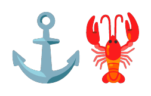

<p align="center">
  
</p>

<h1 align="center">Command Claw</h1>

<p align="center">
  <strong>The agentic half of a two-part system — a greenfield Rust rebuild.</strong><br>
  <em>CommandClaw decides what to do and whether to act; CKRV does it deterministically and proves it done.</em><br>
  <sub>Built to understand how agents work by hand-rolling the loop — not to ship a framework.</sub>
</p>

---

> [!WARNING]
> **Beta Software** — This project is under active development (mid-M1; see Architecture). Workflows and commands may be incomplete or broken. Your feedback helps make this better!
>
> Have feedback or found a bug?  Reach out at [**@_Shikh4r_** on X](https://x.com/_Shikh4r_)

## Quick Start

Prerequisites: Rust (stable), a Telegram bot token from [@BotFather](https://t.me/BotFather), and an OpenAI-compatible API key.

```bash
# 1. Clone and enter
gh repo clone FnSK4R17s/commandclaw
cd commandclaw

# 2. Configure
cp .env.example .env
# Edit .env — set TELOXIDE_TOKEN, OPENAI_API_KEY, COMMANDCLAW_MODEL

# 3. Run
cargo run -p commandclaw
```

Message your bot — it replies via the model. That is the current round-trip (Telegram → agent → model → reply). What comes next is in [plan/M1-delegation-slice.md](plan/M1-delegation-slice.md).

> The rebuild currently lives on the `feat/rust-rebuild` branch. `main` still holds the superseded Python tree until the rebuild merges.

## Architecture

CommandClaw is being **rebuilt greenfield in Rust**. The previous Python/LangGraph runtime — LangChain execution loop, Docker-per-agent, Presidio/NeMo guardrails, Langfuse — is superseded and discarded. The decision, the milestone, and the surviving tenets live in the ADRs: [ADR-0001](docs/adr/0001-rebuild-commandclaw-rust.md) (rebuild + thin MCP seam to CKRV), [ADR-0002](docs/adr/0002-m1-delegation-slice.md) (the M1 delegation slice + tripwire), [ADR-0003](docs/adr/0003-agent-state-version-controlled-markdown.md) (the Vault tenet). Glossary: [CONTEXT.md](CONTEXT.md). Active build plan: [plan/M1-delegation-slice.md](plan/M1-delegation-slice.md). Deeper map: [architecture/commandclaw.md](architecture/commandclaw.md). (The old [guiding_docs/VISION.md](guiding_docs/VISION.md) is superseded.)

**Two products, one thin seam.** CommandClaw is the **agentic layer** — it decides *what* to do and *whether* to act. **CKRV** (Chakravarti) is the **deterministic pipeline** — it decides *how* and proves *done*. When a task needs code changes, CommandClaw authors a *Spec* and delegates it to CKRV across an **MCP seam**, then relays CKRV's **verified diff/PR** back to the user. No code is shared across the seam; the two ship as independent products.

```
Telegram ──▶ CommandClaw (Rust, agentic) ──MCP──▶ CKRV (deterministic) ──▶ verified diff ──▶ PR
```

**Status: mid-M1.** M1 is the thinnest round-trip that crosses the seam — a Telegram message becomes a reviewed PR. Built so far (S0–S2): the Rust workspace, the Telegram channel, and a single-turn model call. The tool-calling agent loop, the Spec authoring, and the CKRV MCP delegation (S3–S6) are the work in progress. Per ADR-0002's **tripwire**, everything else is deliberately deferred until the round-trip closes once — multi-channel, memory/vault, autonomy, skills, the confirmation gate, observability. M1 is intentionally stateless and single-channel.

**Surviving principle (ADR-0003):** when the memory layer lands (post-M1), agent state will be **version-controlled markdown** — the Vault — inspected and edited as files and audited via `git`, not buried in chat or a database.

## Related

- **`commandclaw`** (this repo) — the agent. Greenfield Rust rebuild.
- **CKRV (Chakravarti)** — the deterministic `spec → verified-diff` pipeline CommandClaw delegates to across the seam. Developed locally alongside this repo (`ckrv-mcp` is its stdio MCP server).

The earlier sibling repos (`commandclaw-{gateway,mcp,vault,skills,memory,wiki,observe}`) are superseded or deferred per [ADR-0001](docs/adr/0001-rebuild-commandclaw-rust.md) / [ADR-0002](docs/adr/0002-m1-delegation-slice.md) — not part of the M1 build.

## Configuration

All configuration is environment variables in `.env` (gitignored; copy from [.env.example](.env.example), which groups them by build step):

| Variable | Purpose |
|---|---|
| `TELOXIDE_TOKEN` | Telegram bot token (from @BotFather). |
| `COMMANDCLAW_ALLOWED_CHAT_IDS` | Comma-separated chat ids allowed to talk to the bot. Empty = open. |
| `OPENAI_API_KEY` | Key for any OpenAI-compatible endpoint. |
| `OPENAI_BASE_URL` | Optional — point at a non-OpenAI provider. |
| `COMMANDCLAW_MODEL` | Model id (default `gpt-4o-mini`). |

## MCP

MCP is the **seam to CKRV**. CommandClaw is an MCP client; CKRV's `ckrv-mcp` is a stdio MCP server that exposes a run-spec tool. CommandClaw authors a *Spec*, calls the tool, and relays the verified diff/PR back. Transport and spawn mechanics are in [plan/M1-delegation-slice.md](plan/M1-delegation-slice.md) ("Seam mechanics"). Not yet wired — S4/S6.

The phantom-token credential proxy (`commandclaw-mcp`) is a separate, deferred concern — post-M1, per the tripwire.

## Testing

```bash
cargo test --all                            # tests
cargo clippy --all-targets -- -D warnings   # lints
cargo fmt --all -- --check                  # formatting
```

CI runs all three on every push ([.github/workflows/rust.yml](.github/workflows/rust.yml)).
